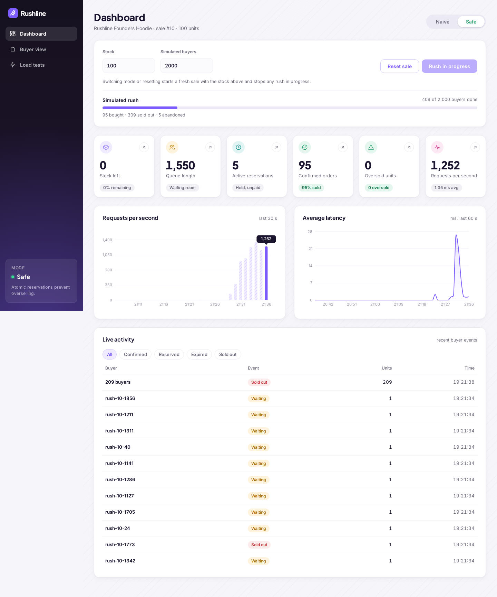
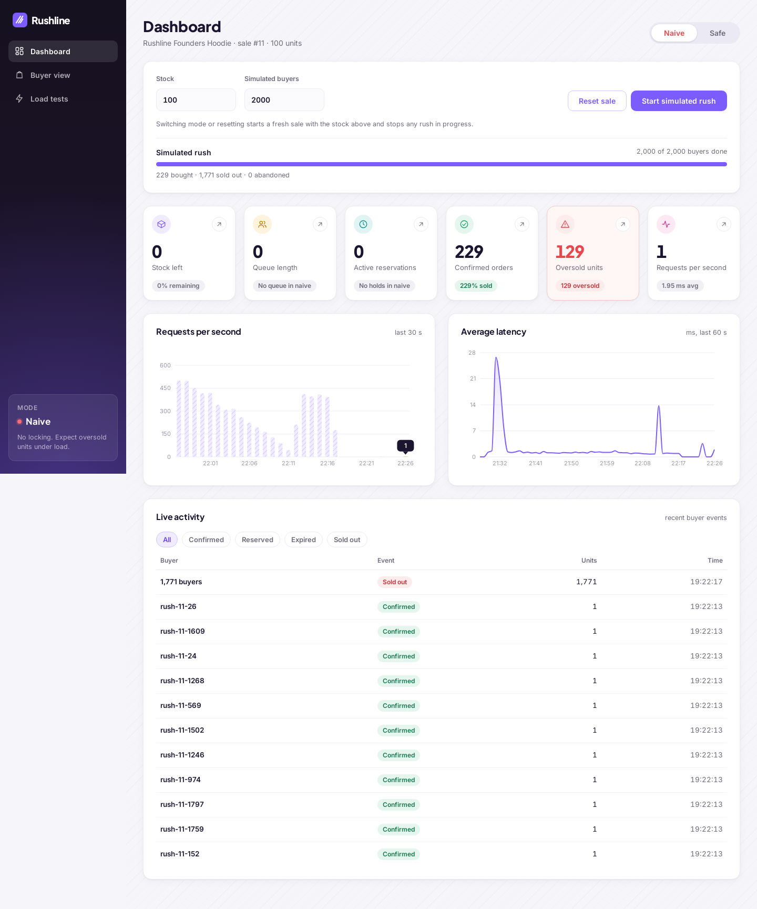
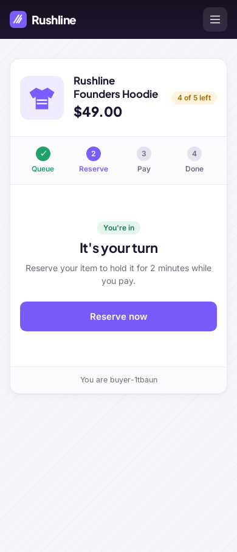
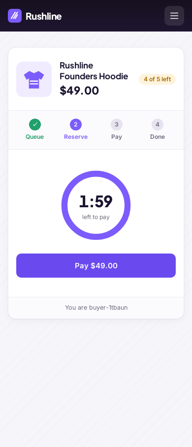
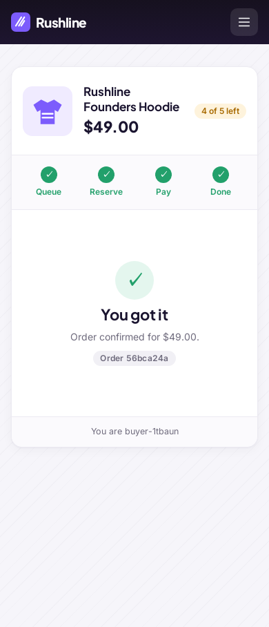
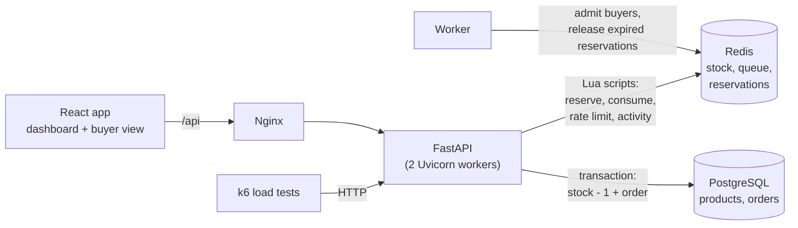
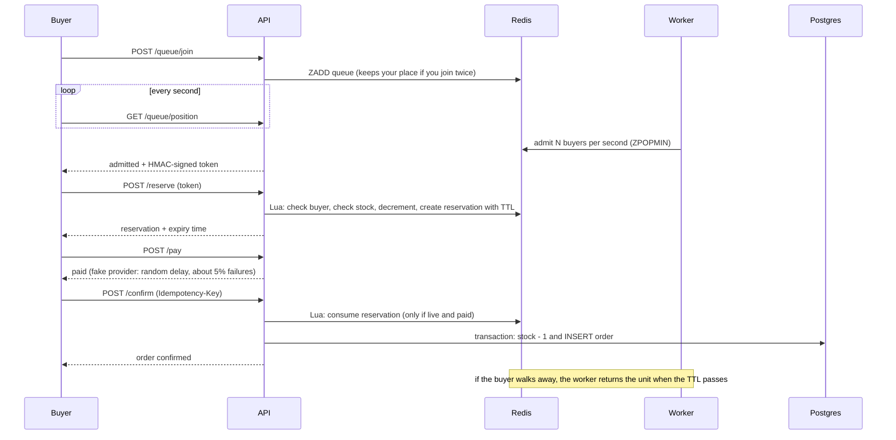

# Rushline

A flash-sale checkout engine built for Black Friday style rushes: thousands of buyers go for a few units at the same moment, nobody gets oversold, the queue is fair, and the performance is measured instead of assumed.



## Why this exists

A normal checkout does "read the stock, then subtract one". That is fine for one buyer at a time. When 5,000 buyers hit it together, hundreds of them read "100 left" before any of them has written "99 left", and the shop sells units it does not have. Rushline keeps that naive version on purpose and builds a safe one next to it, so you can watch the difference live and see it in numbers.

- **Naive mode:** a plain Postgres read-then-write. It oversells.
- **Safe mode:** a waiting room, atomic Redis reservations, an expiry worker, idempotent order writes and per-buyer rate limits. It cannot oversell.

## Run it

You need Docker. Node 18+ and k6 are only needed for the load tests.

```bash
docker compose up --build        # UI: http://localhost:8080   API docs: http://localhost:8000/docs
docker compose run --build --rm tests   # 26 backend tests, inside Python 3.12
```

Open the dashboard, click **Safe**, then **Start simulated rush**. Then click **Naive** and do it again. Open `/buy` in another tab (or on your phone) to go through the buyer flow yourself, but switch the dashboard to Safe first.

| Dashboard, Naive mode after a rush | Buyer view on a phone |
|---|---|
|  |    |

## Architecture



| Piece | Job |
|---|---|
| **FastAPI** (async) | All HTTP routes. Naive and safe checkout, queue, admin stats. |
| **Redis** | The hot path: stock counter, waiting-room queue, reservations (sorted set scored by expiry), rate limits. Every multi-step change is one Lua script, so it is atomic. |
| **PostgreSQL** | The source of truth for products and orders. |
| **Worker** | Every 200 ms: admits the next buyers from the queue at a configurable rate, and returns stock from expired reservations. |
| **React + Vite** | Live dashboard and buyer view, served by nginx. |
| **k6** | Load tests, run from your machine against the stack. |

## How the safe checkout works



1. **Waiting room.** Buyers join a Redis sorted set scored by arrival order and can poll their position. The worker admits buyers at `ADMISSION_RATE_PER_SECOND` and the API hands them a signed token (HMAC-SHA256 of buyer, sale and expiry). Reserving without a valid token for that buyer returns 401.
2. **Reserve.** One Lua script checks that the buyer has not already bought or reserved, checks that stock is above zero, decrements it, and records a reservation that expires after `RESERVATION_TTL_SECONDS` (default 120). Redis runs a script start to finish without interleaving anything, which is what makes overselling impossible here.
3. **Pay.** A fake provider with a random 200 to 800 ms delay and a 5% failure rate. A failed payment keeps the reservation, so the buyer can retry until it expires.
4. **Confirm.** Requires an `Idempotency-Key` header. A Lua script consumes the reservation (it must be live and paid), then one Postgres transaction decrements stock and inserts the order. Retrying with the same key returns the original order, never a second one.
5. **Expiry.** The worker releases reservations whose TTL has passed and puts the units back in stock.
6. **Rate limiting.** Each buyer gets a sliding window of 30 requests per 10 seconds, over a sorted set with one entry per request.

## Design decisions and tradeoffs

- **Redis gates, Postgres also decrements.** Redis decides who gets a unit, but the confirm transaction also decrements `products.stock_remaining` under a `CHECK (stock_remaining >= 0)`. If a bug or a Redis restart ever let too many through, Postgres would refuse the extra order. The cost is a row lock on the product row at confirm time, which is a hotspot by design. I chose the extra safety over the extra speed.
- **`ZREM` is the single gate between "sold" and "expired".** The worker's expiry and the confirm's consume both remove the reservation from the same sorted set, and only one of them can succeed. So a reservation can never be both sold and returned to stock.
- **Consume first, then write, then compensate.** Confirm consumes the reservation before writing to Postgres. If the write fails, the unit is put back. The alternative (write first, consume second) could sell a unit the worker has just returned. The remaining risk is a process crash between the two steps, which would strand one unit. `app.reconcile` would flag it.
- **Idempotency in two layers.** A Redis `SET NX` stops two copies of the same request running at once, and a unique index on `(product_id, idempotency_key)` is the backstop. Keys are scoped to a sale.
- **Sliding window log, not a counter.** It is exact and has no burst at window boundaries, at the cost of one sorted-set entry per request in the window.
- **Stateless admission tokens.** The signature proves the waiting room let the buyer in, so `/reserve` does no extra lookup.
- **Metrics are recorded in memory and flushed to Redis once a second**, so measuring requests per second does not add a Redis call to every request.
- **Naive mode is kept deliberately.** It is the baseline that makes the safe numbers meaningful.
- **A held reservation holds stock.** This is the real tradeoff of reserving: while a buyer holds a unit, everyone else sees "sold out", even though that unit may come back after the TTL. The abandoned-checkout results below show exactly this cost.
- **No authentication.** `buyer_id` is supplied by the client and the admin routes are open. The token only proves the waiting room admitted that ID. A real deployment would put real identity in front of this.

## Results

Every number below came from `node loadtest/run-comparison.mjs`, run once on my machine, and is saved in [loadtest/results/results.json](loadtest/results/results.json) (raw k6 output in `loadtest/results/raw/`).

**Machine:** Apple M5, 10 cores, 16 GB RAM, macOS (Darwin 25.5.0). API, worker, Postgres and Redis ran in Docker Desktop; k6 ran on the same machine, so the load generator and the system under test shared the CPU.
**Settings:** waiting-room admission raised to 1,000/s so the tests measure the checkout engine, not the deliberate 50/s throttle; activity feed off; everything else at defaults. Latency excludes `/pay`, because the fake provider sleeps on purpose.

| Scenario | Mode | Buyers | Throughput (req/s) | p50 (ms) | p95 (ms) | p99 (ms) | Error rate | Orders | Oversold |
|---|---|---:|---:|---:|---:|---:|---:|---:|---:|
| steady | naive | 3,001 | 100 | 2 | 3.7 | 6.4 | 0% | 3,001 / 10,000 | 0 |
| steady | safe | 3,001 | 462.2 | 1 | 2.2 | 3 | 0% | 3,001 / 10,000 | 0 |
| **spike** | **naive** | 5,000 | 1,415.2 | 2,446.3 | 3,239.4 | 3,280.6 | 0% | **5,000 / 100** | **4,900** |
| **spike** | **safe** | 5,000 | 3,531.8 | 242.1 | 1,217.4 | 2,795.6 | 0% | **100 / 100** | **0** |
| abandon | naive | 601 | 2.9 | 3.9 | 6 | 8 | 0% | 100 / 100 | 0 |
| abandon | safe | 601 | 32.3 | 1.8 | 3.7 | 5.8 | 0% | 84 / 100 | 0 |

Latency of only the contended step (naive checkout, or safe-mode reserve):

| Scenario | Mode | p50 (ms) | p95 (ms) | p99 (ms) |
|---|---|---:|---:|---:|
| steady | naive | 2 | 3.7 | 6.4 |
| steady | safe | 0.8 | 1.1 | 1.5 |
| spike | naive | 2,446.3 | 3,239.4 | 3,280.6 |
| spike | safe | 5.4 | 265.3 | 533.6 |
| abandon | naive | 3.9 | 6 | 8 |
| abandon | safe | 1.2 | 1.7 | 2.7 |

The three scenarios: **steady** is 100 new buyers per second for 30 s with 10,000 units; **spike** is 5,000 buyers arriving at the same instant for 100 units; **abandon** is 10 buyers per second for 60 s for 100 units, where 70% reserve and never pay, with a 10 s reservation TTL so expiry happens inside the test.

### What the numbers say

- **The spike is the headline.** With 5,000 buyers for 100 units, naive mode took 5,000 orders: 4,900 units that do not exist. Safe mode took exactly 100 and turned the other 4,900 away, with zero errors. The reconciliation script flags the naive sale as failed and the safe one as correct.
- **Naive was also slower during the spike**, not just wrong. Each naive request makes three sequential Postgres calls through a small connection pool, so 5,000 of them queue up (p50 about 2.4 s). Safe mode rejects the 4,900 losers in Redis in milliseconds and only 100 buyers ever touch Postgres.
- **With stock to spare, both modes were fine.** In the steady scenario neither oversold, because 3,001 buyers never competed for 10,000 units. Naive mode's bug only appears under contention, which is why it survives testing with one user at a time.

### Caveats, said plainly

- **Throughput is not like for like.** A naive buyer makes 1 request. A safe buyer makes about 5 (join, several position polls, reserve, pay, confirm), so safe mode's higher req/s mostly reflects its polling, not a faster checkout. Compare latency and oversold units, not req/s.
- **The abandon scenario is not a fair fight.** In naive mode "abandoning" just means not sending a request, so nothing is ever held. Naive sold all 100 units without oversell at this gentle 10 buyers per second, which also shows the bug needs concurrency.
- **Safe mode left 16 of 100 units unsold in the abandon scenario.** Buyers who arrived while abandoned reservations were still holding stock were told "sold out" and left. Those units came back after the TTL, but nobody was left to buy them. A waitlist that re-offers returned units would fix it; I did not build one.
- **One run, one machine.** Earlier development runs of the spike on the same machine gave naive p95 of 2,670 ms and safe p95 of 1,372 ms, against 3,239 ms and 1,217 ms in the table, so expect roughly 20% variation between runs. Treat the oversold counts and the 100 / 100 outcome as the stable results and the milliseconds as approximate.
- **The load generator shared the CPU** with everything it was testing.

### Reproduce

```bash
brew install k6                                  # once
node loadtest/run-comparison.mjs                 # all 6 runs, about 5 minutes, saves loadtest/results/results.{json,md}
SCENARIOS=spike MODES=safe node loadtest/run-comparison.mjs   # one cell, saved as results-partial.*
docker compose exec api python -m app.reconcile  # check the latest sale: orders never exceed starting stock
```

The runner restarts the API and worker with the benchmark settings, creates the sale, runs k6, waits for reservations to drain, reads the stats, runs the reconciliation check, and puts the stack back to normal settings at the end.

## Tests

`docker compose run --build --rm tests` runs 26 tests against real Postgres and Redis. The ones that matter most:

- **200 buyers race for 25 units with 20% payment failures. Exactly 25 orders result**, zero oversold, and the reconciliation check passes.
- **500 simultaneous reserves for 10 units: exactly 10 succeed.**
- **Ten identical confirm requests at once create one order.**
- Expired reservations return stock and cannot be paid or confirmed; tampered, wrong-buyer and missing admission tokens are rejected; the sliding window limiter blocks and then recovers.
- **Naive mode demonstrably oversells.**
- A reset in the middle of a simulated rush does not leak old buyers into the new sale.

The tests use their own Redis database and a separate `rushline_test` Postgres database, so they never touch data from a live demo. GitHub Actions runs them on every push ([.github/workflows/ci.yml](.github/workflows/ci.yml)).

## Project layout

```
backend/app/
  main.py            FastAPI app, middleware, lifespan
  routers/           naive.py  queue.py  checkout.py  admin.py
  lua/               reserve  consume  expire  admit  rate_limit  mark_paid  push_event
  worker.py          admission + reservation expiry loop
  rush.py            simulated rush used by the dashboard button
  reconcile.py       "orders never exceed stock" checker
  tokens.py          HMAC admission tokens
  sales.py  events.py  metrics.py  ratelimit.py  config.py  context.py  keys.py  schema.sql
backend/tests/       pytest suite
frontend/src/        React + TypeScript app (pages/, components/)
loadtest/            k6 script, run-comparison.mjs, results/
docker-compose.yml   postgres, redis, api, worker, web (+ tests profile)
```

## Configuration

Environment variables (see [.env.example](.env.example)): `RESERVATION_TTL_SECONDS` (120), `ADMISSION_RATE_PER_SECOND` (50), `RATE_LIMIT_MAX` (30) and `RATE_LIMIT_WINDOW_SECONDS` (10), `PAYMENT_FAILURE_RATE` (0.05), `ACTIVITY_LOG` (true), `HMAC_SECRET`.

## What I would do next

- A waitlist that re-offers units returned by expired reservations.
- Real authentication for buyers and admin routes.
- Postgres read replicas, or sharding the stock row, if confirm becomes the bottleneck.
- Separate load-generator hardware, so the benchmark is not sharing a CPU with the system under test.
